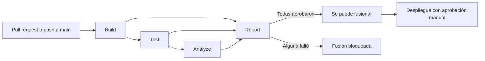

# Manual técnico del pipeline

Cómo funciona el pipeline de calidad, por qué se diseñó así y cómo mantenerlo. Los umbrales y su justificación están en [SQA-Plan.md](SQA-Plan.md).

## Arquitectura

| Etapa | Qué hace | Falla si |
|---|---|---|
| **Build** | Instala las dependencias, revisa la sintaxis de los servicios, compila el frontend y comprueba los subagentes | No compila o el `package-lock.json` no coincide |
| **Test** | Levanta PostgreSQL y el banco de prueba, aplica las migraciones, crea las cuentas de prueba y ejecuta las pruebas unitarias, de integración, de regresión y del frontend | Falla una prueba o la cobertura queda bajo el umbral |
| **Analyze** | Ejecuta ESLint, Prettier, `npm audit` y SonarCloud | Hay errores de lint o de formato, vulnerabilidades críticas o altas, o SonarCloud rechaza el Quality Gate |
| **Report** | Publica el resumen de etapas y de cobertura | Alguna etapa anterior no aprobó |

El workflow está en `.github/workflows/ci.yml` y conserva el nombre `CI`, porque el despliegue (`deploy.yml`) se dispara con ese nombre.

## Decisiones técnicas

| Decisión | Motivo |
|---|---|
| **Report corre siempre** (`if: always()`) y revisa el resultado de las demás etapas | GitHub trata un trabajo omitido como aprobado. Sin esto, un fallo en Test dejaría pasar la protección de `main` |
| **Base de datos real en Test**, con Docker Compose | Los permisos por rol y los triggers de auditoría son parte de lo que se prueba, y una base simulada no los ejercita |
| **Credenciales al azar en cada ejecución** | Los registros de Actions son públicos. Esas credenciales dejan de servir al terminar el trabajo |
| **La base nace sin usuarios** y el CI crea las cuentas de prueba con `scripts/crearUsuariosPrueba.js` | Antes `database.sql` creaba 5 cuentas con una contraseña conocida, también en producción. Ahora esas cuentas solo existen en desarrollo y en el CI, y producción empieza con `scripts/crearAdministrador.js` |
| **Dos herramientas de cobertura en el backend:** `c8` y Jest | Los scripts de regresión son procesos de Node independientes, que Jest no puede instrumentar. SonarCloud combina los dos reportes LCOV |
| **`npm ci --ignore-scripts`** | Evita que un paquete ejecute código durante la instalación |
| **Vitest en Node 22** y el resto en Node 20 | La versión de Vitest sin vulnerabilidades críticas exige Node 22. Solo se usa para probar; la imagen de producción sigue en Node 20 |
| **Prettier solo sobre el código nuevo de calidad** | Reformatear toda la aplicación tocaría cientos de archivos de un sistema en uso, sin cambiar su comportamiento |
| **`banco-backend` fuera de la cobertura** | Es un simulador del banco que corre en su contenedor durante las pruebas. Sí pasa por ESLint, `npm audit` y SonarCloud |

## Configuración

| Elemento | Dónde | Para qué |
|---|---|---|
| `SONAR_TOKEN` | GitHub → Settings → Secrets and variables → Actions | Autoriza el análisis de SonarCloud |
| Análisis automático | SonarCloud → Administration → Analysis Method → desactivado | Es incompatible con el análisis desde el CI |
| Protección de `main` | GitHub → Settings → Branches | Exige pull request y los checks `Build`, `Test`, `Analyze` y `Report` |
| Configuración del análisis | `sonar-project.properties` | Código fuente, pruebas, reportes y exclusiones de cobertura |
| Umbral del backend | `COBERTURA_MINIMA` en `backend/scripts/regresion.js` | Cobertura mínima de `backend/src` |
| Umbral del frontend | `thresholds` en `frontend/vite.config.js` | Cobertura mínima de `frontend/src` |
| Umbral de las utilidades | `coverageThreshold` en `backend/jest.config.js` | Cobertura mínima de las funciones con prueba unitaria |

## Ejecutar los controles en local

Requisitos: Node 22 o 24 y Docker Desktop.

| Control | Comando | Carpeta |
|---|---|---|
| Pruebas unitarias | `npm run test:unit` | `backend/` |
| Pruebas de integración | `npm run test:integracion` | `backend/` |
| Pruebas de regresión | `npm run test:regresion` | `backend/` |
| Regresión con cobertura | `REGRESION_COBERTURA=1 npm run test:regresion` | `backend/` |
| Pruebas del frontend | `npm run test:cobertura` | `frontend/` |
| Lint | `npm run lint` | `backend/`, `banco-backend/`, `frontend/` |
| Vulnerabilidades | `npm audit --audit-level=high` | `backend/`, `banco-backend/`, `frontend/` |

Las pruebas de integración y de regresión usan la base local y el banco de `docker compose up -d`, y las cuentas de prueba del personal. En una base nueva, créelas una vez desde `backend/` con `node scripts/crearUsuariosPrueba.js`, con `USUARIOS_PRUEBA_PASSWORD=admin123` en `backend/.env`. Modifican datos de prueba, así que no se deben ejecutar contra producción.

## Guía de mantenimiento

| Tarea | Cómo hacerla |
|---|---|
| Agregar una prueba del backend | Crear `backend/tests/unit/*.test.js` o `backend/tests/integration/*.test.js`. Jest las encuentra solo |
| Agregar una prueba del frontend | Crear `frontend/src/test/**/*.test.{js,jsx}`. Las respuestas simuladas de la API están en `frontend/src/test/paginas/datos.js` |
| Agregar un script de regresión | Crear `backend/test*.js`, con código de salida distinto de 0 si falla. `scripts/regresion.js` lo encuentra solo |
| Corregir un error | Agregar primero una prueba que falle por ese error, para que no vuelva a aparecer |
| Cambiar un umbral | Cambiarlo en el archivo de configuración y en `SQA-Plan.md`, en el mismo pull request |
| Excluir un archivo de la cobertura | Agregarlo a `sonar-project.properties` y declarar el motivo en `SQA-Plan.md` |
| Renombrar un trabajo del CI | Cambiar los checks obligatorios de `main` en el mismo paso, o los pull requests quedan bloqueados |

## Problemas frecuentes

| Síntoma | Causa | Solución |
|---|---|---|
| El pull request espera checks que nunca terminan | Se renombró un trabajo del CI | Actualizar los checks obligatorios de `main` |
| SonarCloud falla con un aviso de análisis automático | Se volvió a activar en SonarCloud | Desactivarlo en Analysis Method |
| Falla `npm audit` sin cambios en el código | Se publicó una vulnerabilidad nueva | Ejecutar `npm audit fix` y volver a probar |
| Un merge queda esperando en Despliegue | El ambiente `production` pide aprobación | Aprobar si cambió código de la aplicación; rechazar si solo cambiaron pruebas o documentos |
